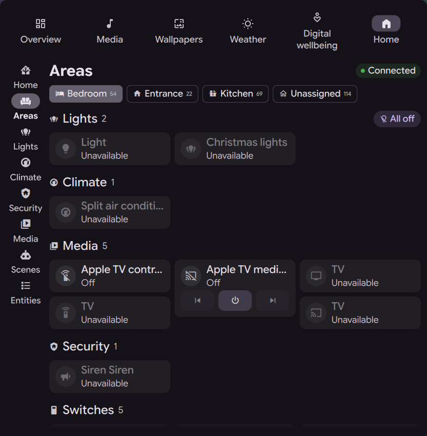
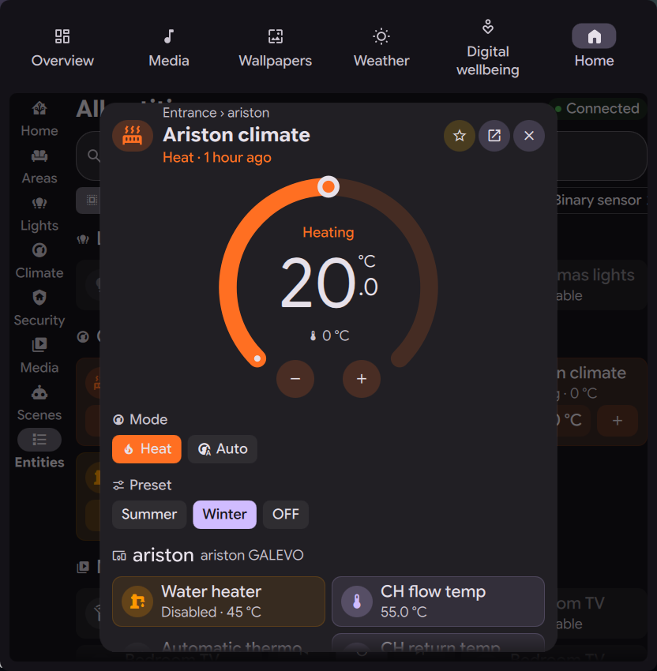
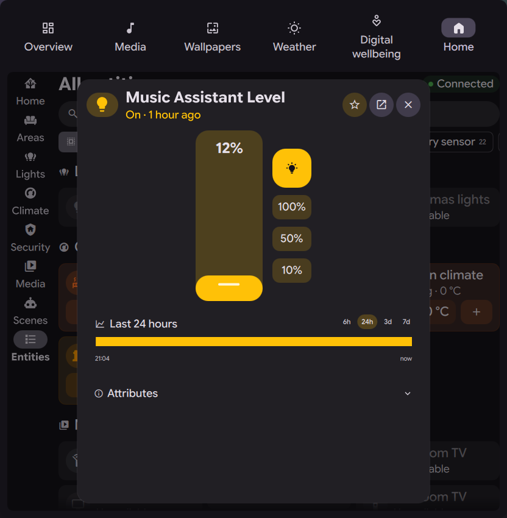
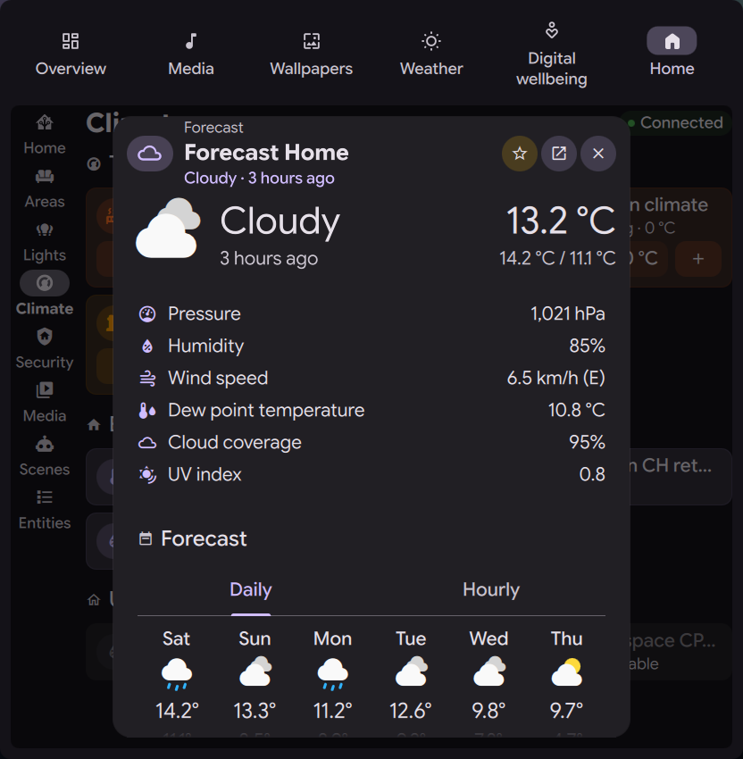
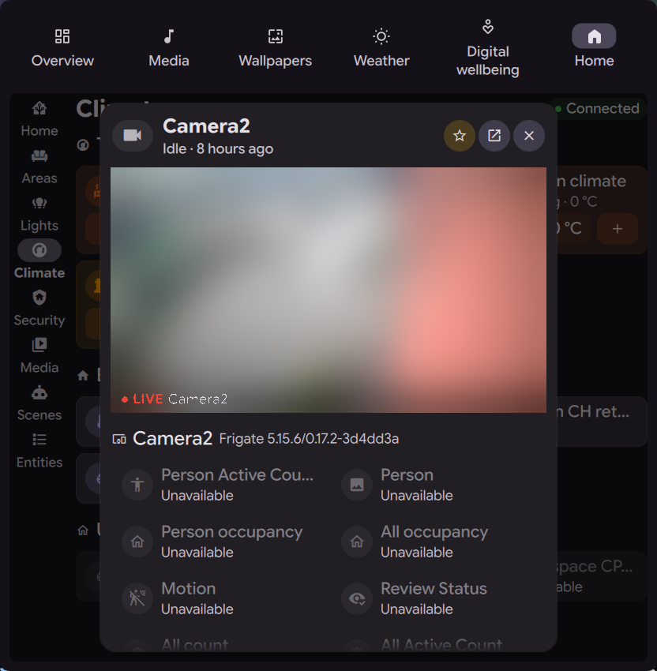
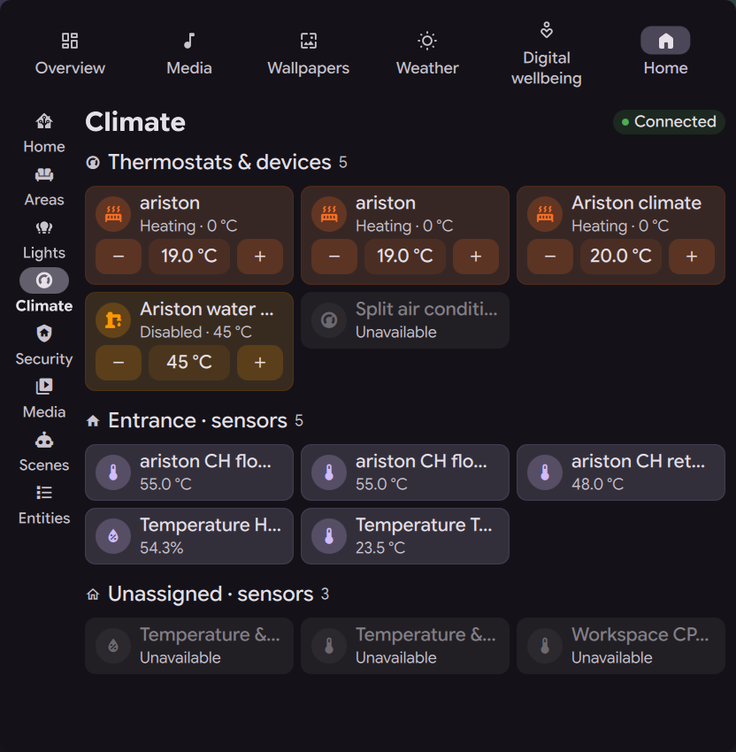
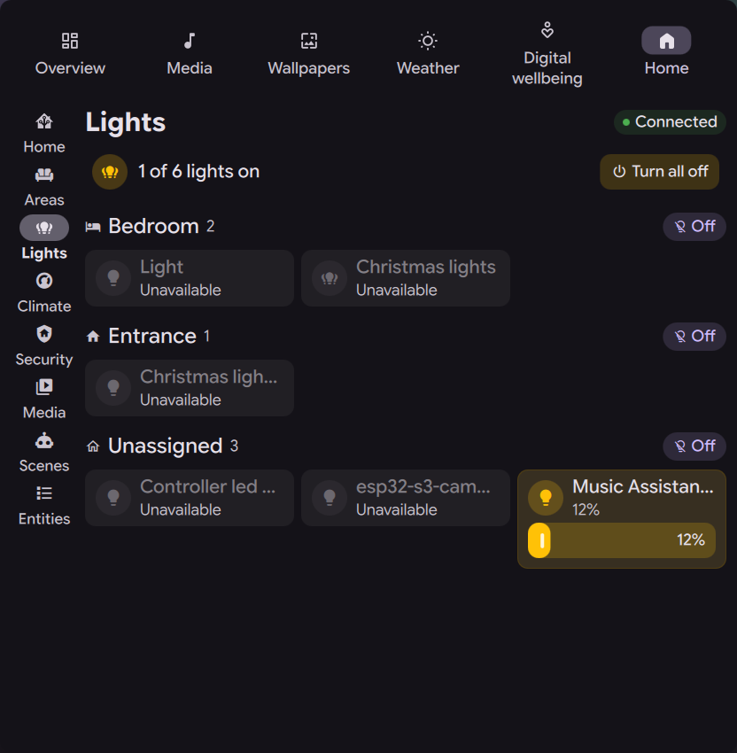
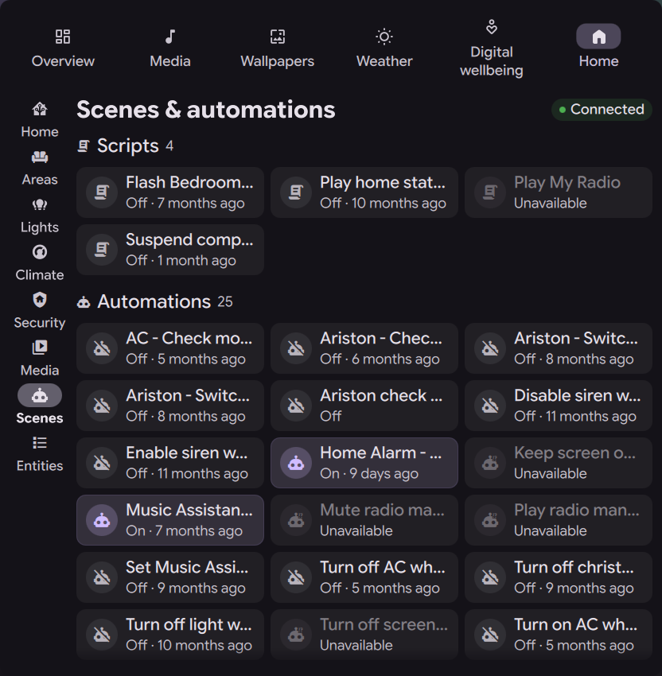
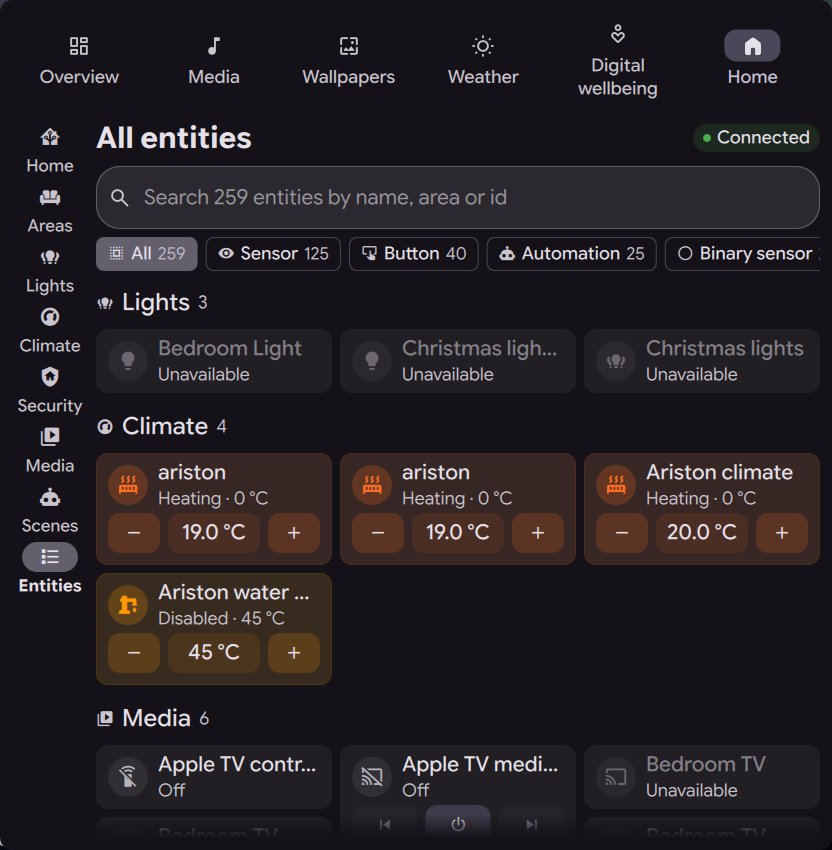

# Home Assistant for DankMaterialShell

Your Home Assistant inside the DankMaterialShell dashboard, with the same icons, colors, state names and controls as the Home Assistant frontend, laid out with Material You cards.



| Thermostat | Light | Weather | Camera |
| --- | --- | --- | --- |
|  |  |  |  |

| Climate | Lights | Scenes & automations | All entities |
| --- | --- | --- | --- |
|  |  |  |  |

## Contents

- [Features](#features)
- [Requirements](#requirements)
- [Installation](#installation)
- [Configuration](#configuration)
- [Usage](#usage)
- [IPC and keybinds](#ipc-and-keybinds)
- [How it matches Home Assistant](#how-it-matches-home-assistant)
- [Troubleshooting](#troubleshooting)
- [Project structure](#project-structure)
- [Development](#development)
- [Credits](#credits)
- [License](#license)

## Features

### Dashboard tab

A **Home** tab in the DMS dashboard, next to Overview, Media and Weather. A navigation rail like the Home Assistant sidebar opens these pages:

| Page | What it shows |
| --- | --- |
| **Home** | Greeting, badges (people, weather, lights on, thermostats, open doors and windows, available updates), persistent notifications with dismiss, favorites, now playing media and area cards |
| **Boards** | Your own Home Assistant dashboards, with their views, sections and cards (see [Your dashboards](#your-dashboards)) |
| **Areas** | One chip per area (plus *Unassigned*). Entities grouped into Lights, Climate, Covers, Media, Security, Switches, Controls, Actions and Sensors |
| **Lights** | Every light grouped by area, with *Turn all off* globally and per area |
| **Climate** | Thermostats, water heaters, humidifiers and fans, then temperature and humidity sensors per area |
| **Security** | Live camera snapshots, alarm panels, locks, sirens, and door, window, motion, smoke, leak and other safety sensors |
| **Media** | Media players with artwork, transport controls, volume and progress |
| **Scenes** | Scenes, scripts and automations |
| **Entities** | Search by name, area or entity id, with domain filter chips and an *Updates* view |

### Your dashboards

The **Boards** page renders the dashboards you built in Home Assistant, read with `lovelace/config`. Chips at the top switch between dashboards and their views. When you edit a dashboard in Home Assistant, the page updates by itself (`lovelace_updated`).

- **Views**: sections (the 12-column grid with `grid_options`, `column_span` and `max_columns`), masonry, panel, and sidebar (laid out like masonry), plus view badges. Subviews are reachable through navigate actions.
- **Cards**: tile (with `features`, `features_position`, `vertical`, `state_content`, `hide_state`, `color`, `icon`, `name`), heading (with entity badges), entities, entity, sensor (with graph), button, glance, grid, vertical and horizontal stack, conditional, weather forecast, thermostat, light, media control, picture entity (live video with `camera_view: live`), picture glance, picture, to-do list and shopping list, markdown (templates rendered by Home Assistant), gauge, history graph, statistics graph, area and map (the tracked entities, with a link to the map in Home Assistant).
- **Tile features**: brightness, fan speed, cover open/close, target temperature, media controls, HVAC modes, preset, fan, swing and water heater modes, select options, numeric input (buttons or slider), toggle and button.
- **Actions**: `tap_action`, `icon_tap_action` and `hold_action` (right click on tiles and buttons) with `more-info`, `toggle`, `navigate`, `url`, `perform-action` and `none`.
- **Visibility**: card and section `visibility` conditions (state, numeric state, user, and/or/not) and view `visible`.
- Custom cards (HACS) and card types not listed above show a placeholder with a link to the view in Home Assistant. Dashboards generated by a strategy, like the default *Overview*, point you to the Areas page or open in the browser.

### Tiles

Entities are shown as Home Assistant style **tile cards**:

- Tap the icon to toggle, run, lock or unlock. Tap the tile to open the details dialog.
- Inline controls under the tile: brightness, fan speed, cover open/stop/close, target temperature −/+, media transport, number sliders.
- Active tiles are tinted with the state color. A light uses the actual color of the bulb.
- The grid packs tiles of different heights into columns (masonry).

### Details dialog ("more info")

| Domain | Controls |
| --- | --- |
| Light | Large brightness slider, on/off, 100/50/10% presets, color temperature, hue slider and swatches, effects |
| Climate, water heater | Thermostat dial (drag, scroll or −/+), current temperature, HVAC / operation modes, presets, fan and swing modes, low/high setpoints |
| Cover, valve | Position slider, open/stop/close, tilt |
| Fan | Speed slider, on/off, oscillation, direction, presets |
| Media player | Artwork, transport, volume, mute, power, source and sound mode |
| Switch, input boolean, siren, remote, humidifier | Large vertical switch (plus a target humidity slider for humidifiers) |
| Automation | Enable/disable, *Run actions*, last triggered |
| Lock | Lock, unlock, open |
| Scene, script, button | Activate, run, stop or press |
| Select, number | Options or slider |
| Alarm panel | Every supported arm mode and disarm |
| Vacuum, lawn mower | Start, pause, stop, dock, locate |
| Update | Installed and latest version, release summary, install, skip |
| Camera | Live video: HLS when the camera offers it, otherwise the MJPEG stream, like the HA frontend (needs Qt Multimedia, falls back to a snapshot every 2 seconds). Cards on the pages show snapshots every 10 seconds |
| Weather | Condition with HA-style colored icons, temperature with today's high/low, pressure, humidity, wind with direction and the other measurements the integration reports, daily / hourly / twice daily forecast with precipitation |
| Person | Picture, zone, coordinates |
| Sensor, binary sensor | Large value |

Every dialog also has:

- **History** for 6 h, 24 h, 3 days or 7 days. Numeric entities get a line chart with min, average and max. Everything else gets a colored state timeline. Hover shows value and time.
- **Related entities** of the same device, as tiles.
- **Attributes**, with names translated by Home Assistant.
- A **favorite** star and a link to the history page in Home Assistant.

### Other surfaces

- **Overview card**: your favorites as quick toggles, resizable from 2×1 to 8×6 cells. At one row high it becomes a row of icon toggles. A click opens the Home tab.
- **Bar widget**: shows how many lights are on, or the state of an entity you choose. Click opens the Home tab. Right click toggles the chosen entity.
- **Background daemon**: holds a single WebSocket connection for every surface and exposes [IPC commands](#ipc-and-keybinds).

## Requirements

- **DankMaterialShell 2.0 or newer**, with the dash plugin API (`DashTabComponent`, `DashCardComponent`)
- **Qt WebSockets** for Qt 6:
  - Arch: `qt6-websockets`
  - Fedora: `qt6-qtwebsockets`
  - Debian / Ubuntu: `qml6-module-qtwebsockets`
- A **Home Assistant** instance reachable from your machine, with a long-lived access token
- Optional: **Qt Multimedia** with the FFmpeg backend, for live camera video in the details dialog. Without it cameras show snapshots.
  - Arch: `qt6-multimedia` and `qt6-multimedia-ffmpeg`
  - Fedora: `qt6-qtmultimedia`
  - Debian / Ubuntu: `qml6-module-qtmultimedia`

Tested on [dux-shell](https://github.com/duxlabs-dev/dux-shell) 2.0.0 (DMS 2.0), Qt 6.12 and Home Assistant 2026.9.

## Installation

Clone the repository into your DMS plugins folder. The folder name does not matter.

```sh
git clone https://github.com/ghosty2004/dms-home-assistant \
  ~/.config/DankMaterialShell/plugins/homeAssistantDash
```

Then enable the plugin:

1. Open **Settings → Plugins** and enable **Home Assistant**. If it is not listed yet, run `dms ipc call plugin-scan scan`.
2. The **Home** tab shows up in the dashboard right away.
3. Optional:
   - add the **Home Assistant** card from the dashboard edit mode (*Add widget*);
   - add the **Home Assistant** widget to your bar in the bar settings.

From a terminal:

```sh
dms ipc call plugin-scan scan
dms ipc call plugins enable homeAssistantDash
```

## Configuration

Open **Settings → Plugins → Home Assistant**:

| Setting | Description |
| --- | --- |
| Home Assistant URL | e.g. `http://homeassistant.local:8123` or `https://ha.example.com`. The WebSocket URL is derived from it. |
| Long-lived access token | Create one in Home Assistant under **Profile → Security → Long-lived access tokens**. |
| State colors | *Home Assistant*: the exact frontend colors (amber lights, orange heating, purple covers…). *Harmonized with theme*: the same meaning, using the accent hues of your DMS theme. *Theme accent*: everything active in your primary color. |
| Show unavailable entities | Turn off to hide entities whose state is `unavailable`. |
| Bar entity | Entity shown in the bar widget, e.g. `sensor.outdoor_temperature`. Empty shows how many lights are on. |

If you already use the [Home Assistant Monitor](https://github.com/xxyangyoulin/dms-plugin-hass) plugin, leave URL and token empty and its credentials are reused.

> **Note**
> DMS stores plugin settings, including the token, as plain text in `~/.config/DankMaterialShell/plugin_settings.json`. Use a dedicated token so you can revoke it independently.

### Which entities are shown

The plugin follows the visibility rules of the Home Assistant dashboards:

- Entities marked as hidden, and *config* or *diagnostic* entities, are skipped.
- Areas come from the area registry. An entity without its own area inherits the area of its device.
- Domains that don't make sense as tiles are left out: `update`, `tts`, `stt`, `event`, `zone`, `device_tracker`, `calendar`, `todo`, `image` and similar. Updates still have their own view under *Entities → Updates*.

Favorites are saved in the plugin settings, so they survive restarts.

## Usage

| Action | Result |
| --- | --- |
| Click a tile icon | Toggle / run / lock |
| Click a tile | Open the details dialog |
| Drag a slider, or scroll on it | Change brightness, position, speed or volume. The value is sent when you release, or shortly after the last scroll step. |
| Drag the thermostat arc, or use −/+ | Change the target temperature (sent after a short pause) |
| Star in the dialog | Add or remove a favorite |
| Escape | Close the dialog |
| Click the *Connected* pill | Reconnect |

## IPC and keybinds

The daemon registers an IPC target named `homeassistant`:

```sh
dms ipc call homeassistant open lights           # home | dashboards | areas | lights | climate | security | media | automations | entities
dms ipc call homeassistant area living_room      # open an area by area_id
dms ipc call homeassistant dashboard dashboard-home/bedroom   # open one of your dashboards and a view
dms ipc call homeassistant more climate.living   # open the details dialog of an entity
dms ipc call homeassistant toggle light.kitchen  # toggle, run, lock, press… depending on the domain
dms ipc call homeassistant call scene.turn_on scene.movie_night
dms ipc call homeassistant state sensor.outdoor_temperature
dms ipc call homeassistant status
dms ipc call homeassistant reconnect
```

Example Hyprland keybinds:

```ini
bind = SUPER, H, exec, dms ipc call homeassistant open home
bind = SUPER SHIFT, L, exec, dms ipc call homeassistant toggle light.desk
```

## How it matches Home Assistant

The plugin reads the same data the Home Assistant frontend uses, instead of hardcoding approximations:

- **Icons**: Material Design Icons, the font Home Assistant uses, resolved in the same order as the frontend:
  1. the icon you set on the entity;
  2. the `icon` attribute;
  3. integration icons by translation key (`frontend/get_icons`, category `entity`);
  4. entity component icons by device class and state, including numeric ranges (`frontend/get_icons`, category `entity_component`);
  5. battery level icons;
  6. the frontend fallback icon of each domain.
- **Colors**: the state color variables of the frontend (`--state-light-active-color`, `--state-climate-heat-color`…), including red for problem, smoke or leak sensors, green for locked locks and people at home, and battery level colors. Lights use their RGB color.
- **Active state**: the frontend `stateActive` logic, e.g. a cover is active unless closed, a media player unless standby.
- **Text**: states and attributes go through `frontend/get_translations` in your Home Assistant language, so you see *Detected*, *Heating* or *Open* exactly as in Home Assistant. Numbers respect the display precision you set per entity. Timestamps are shown as relative time.
- **Data**: live updates through `subscribe_entities` (compressed state diffs). Registry changes reload automatically. History comes from `history/history_during_period`.
- **Dashboards**: your Lovelace configuration as stored in Home Assistant, laid out with the same grid sizes and card defaults as the frontend.

## Troubleshooting

| Problem | Fix |
| --- | --- |
| *Not configured* | Set URL and token in the plugin settings. |
| *Offline* with `Invalid access token` | The token was revoked or mistyped. Create a new one. |
| *Offline* with a connection error | Open `<url>/api/` in a browser from the same machine. Behind a reverse proxy, make sure WebSockets are forwarded for `/api/websocket`. |
| `module "QtWebSockets" is not installed` | Install the Qt 6 WebSockets package listed under [Requirements](#requirements). |
| The tab is missing | Check **Settings → Dashboard → Tabs** and that the plugin is enabled. |
| Camera stays on *Loading…* | The camera must provide snapshots (`entity_picture`). Streams without snapshots are not supported. |

Logs:

```sh
journalctl --user -u dms -f | grep -i -E "homeAssistantDash|\[HA\]"
```

## Project structure

```
homeAssistantDash/
├── plugin.json            Manifest (composite: daemon, dash tab, dash card, bar widget)
├── qmldir                 Registers the HaService, Ha and Lovelace singletons
├── HaService.qml          WebSocket client: auth, entity subscription, registries, icons, translations, services, history
├── Ha.qml                 Frontend logic: icons, state colors, active state, state text, grouping, toggle actions
├── Lovelace.qml           Dashboard logic: visibility conditions, grid sizes, actions, named colors
├── HaDaemon.qml           Keeps the connection alive, IPC handler
├── HaDashTab.qml          Dashboard tab: navigation rail, header, pages, details dialog
├── HaDashCard.qml         Overview card
├── HaBarWidget.qml        Bar and dock widget
├── HaSettings.qml         Settings page
├── pages/                 Home, Boards, Areas, category pages (Lights, Climate, Security, Media, Scenes), Entities
├── lovelace/              View layouts, section grid, tile features, entity rows and one file per card type (cards/)
├── components/            Tile, tile grid, tile features, sliders, area card, media card, camera card, chips, nav rail
├── moreinfo/              Details dialog, per-domain controls, thermostat dial, history chart
├── assets/                Material Design Icons font, name → codepoint map, license
└── screenshots/
```

## Development

- Enable the bundled pre-commit hook once per clone: `git config core.hooksPath .githooks`. It refuses commits that contain something looking like a Home Assistant access token. `.gitignore` also excludes DMS settings files, logs, dumps and `.env` files.
- After editing a file, restart the shell with `dms restart`. `dms ipc call plugins reload homeAssistantDash` does not reload the singletons (`HaService`, `Ha`) or components already cached by the QML engine.
- A JavaScript construct that crashes the Qt QML compiler crashes the whole shell. If the plugin is enabled, the shell crashes again on every start. Compile every file before restarting:

  ```sh
  cd ~/.config/DankMaterialShell/plugins/homeAssistantDash
  for f in $(find . -name '*.qml' -o -name '*.js'); do
    /usr/lib/qt6/qmlcachegen --only-bytecode --resource-path "/${f#./}" -o /tmp/qmlcheck.cpp "$f" || echo "FAILED: $f"
  done
  ```

  For example, Qt 6.12 crashes on an optional call inside a `for…in` body (`for (k in o) o[k]?.(x)`).
- `assets/MdiMap.js` is generated from `@mdi/svg/meta.json`: icon names and aliases mapped to codepoints. To update the icons, regenerate it together with `materialdesignicons-webfont.ttf` from the same `@mdi` release.
- To try a page without clicking, use `dms ipc call homeassistant open <page>` and `dms ipc call homeassistant more <entity_id>`.

## Credits

- Inspired by [dms-plugin-hass](https://github.com/xxyangyoulin/dms-plugin-hass) by xxyangyoulin.
- [Material Design Icons](https://pictogrammers.com/library/mdi/) by Pictogrammers, under the Pictogrammers Free License ([assets/MDI-LICENSE](assets/MDI-LICENSE)).
- Icon, color and state semantics follow the [Home Assistant frontend](https://github.com/home-assistant/frontend).
- Built for [DankMaterialShell](https://github.com/AvengeMedia/DankMaterialShell).

This project is not affiliated with or endorsed by Home Assistant or Nabu Casa.

## License

[MIT](LICENSE)
